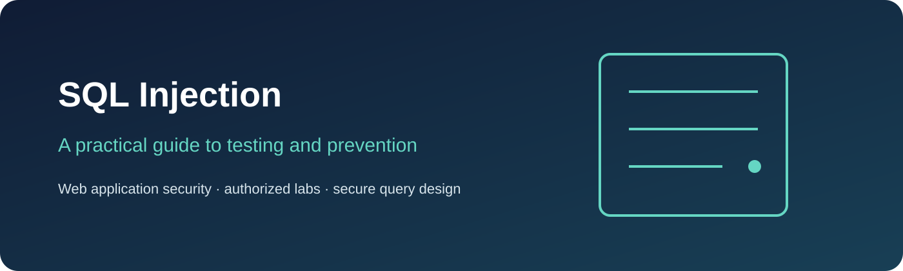
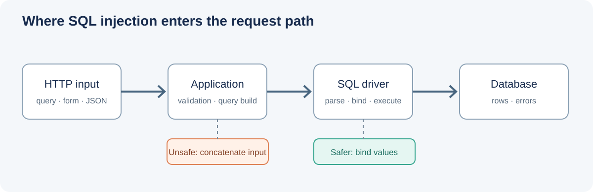

# SQL Injection: Complete Practical Guide

A field guide to identifying, validating, explaining, and preventing SQL injection in web applications. This project is designed for junior-to-intermediate web penetration testers and uses deliberately vulnerable training environments only.

## Objectives

- Understand how application input becomes part of a database query.
- Distinguish in-band, error-based, UNION-based, and blind SQL injection.
- Practice controlled manual testing with Burp Suite Community Edition.
- Record evidence, assess impact without unnecessary data access, and recommend durable fixes.

## Topics

Query construction and trust boundaries · SQLi root causes · DBMS fingerprinting limits · UNION column and type matching · error and boolean/time-based inference · authentication logic · Burp workflow · test methodology · secure query design.

## Repository map

| File | Purpose |
|---|---|
| [theory.md](theory.md) | Query execution model, root cause, and technique taxonomy |
| [practical-examples.md](practical-examples.md) | Safe lab exercises and worked request-level examples |
| [database-enumeration.md](database-enumeration.md) | Cautious DBMS identification and metadata concepts |
| [authentication-bypass.md](authentication-bypass.md) | Login query logic, controlled validation, and impact limits |
| [blind-sql-injection.md](blind-sql-injection.md) | Boolean and timing inference, controls, and caveats |
| [prevention.md](prevention.md) | Parameter binding, allow-lists, review, and defense in depth |
| [testing-methodology.md](testing-methodology.md) | Scoped Burp-based workflow, evidence, mistakes, and reporting |
| [references.md](references.md) | Primary learning and defensive references |
| [images/](images/) | Original diagrams used by this guide |

## Practice environments and tools

Use [PortSwigger Web Security Academy](https://portswigger.net/web-security/sql-injection) labs or [DVWA](https://github.com/digininja/DVWA) in a local, isolated setup. Burp Suite Community Edition provides browser proxying, HTTP history, Repeater, and manual request editing. Follow each lab's instructions; do not point test traffic at public or production systems without explicit written authorization and an agreed scope.

## Learning outcomes

After working through the guide, a tester should be able to trace a user-controlled value into a query, select a low-impact test that distinguishes SQLi from ordinary application behavior, interpret results without overclaiming the DBMS or impact, capture reproducible evidence, and explain a parameterized remediation.

## Safety and authorization

All examples are for applications you own or have explicit permission to test. Use the named training labs or a local intentionally vulnerable application. Do not enumerate real data, attempt privilege escalation, or run destructive statements. Stop when the authorized objective is met. A lab result does not establish that another system is vulnerable.

## References

Start with the [PortSwigger SQL injection topic](https://portswigger.net/web-security/sql-injection), the [OWASP SQL Injection Prevention Cheat Sheet](https://cheatsheetseries.owasp.org/cheatsheets/SQL_Injection_Prevention_Cheat_Sheet.html), and the [OWASP Web Security Testing Guide](https://owasp.org/www-project-web-security-testing-guide/). See [references.md](references.md) for additional material.
