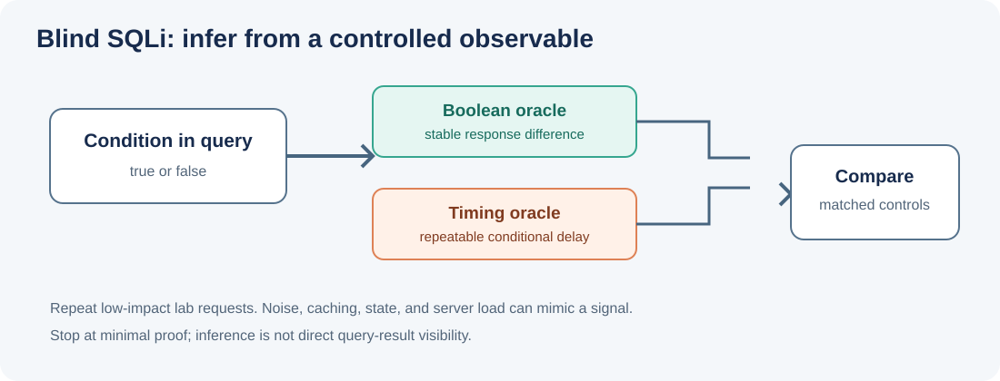

# Blind SQL Injection

Blind SQLi occurs when the application does not directly return query results or useful database errors, but query behavior still influences an observable response or timing.

## Boolean-based inference

**What/how:** A condition evaluates true or false inside the database. The application exposes a repeatable difference, such as content, status, redirect, or a related behavior.

**Recognize/test:** In an authorized lab, send matched true and false conditions while holding the rest of the request constant. Repeat and compare stable response features. Look for a reliable oracle, not one-off noise.

**Interpretation:** A stable differential supports injection in that context. It does not reveal arbitrary values unless further authorized lab work establishes a usable inference channel. Keep the assessment at proof-of-concept level.

**Mistakes:** Comparing requests with different cookies or state, relying on response length alone, ignoring caching, and treating a WAF block page as a true/false signal.

## Time-based inference

**What/how:** A conditional expression causes a delay when a condition is met. The delay is observed in the HTTP response time rather than as returned rows.

**Recognize/test:** Use only a lab-prescribed short delay. Capture baseline latency, then alternate control and conditional requests several times. Compare distributions or medians; avoid concurrent tests that load the application. Burp Repeater timing is useful for small manual samples, not a substitute for rigorous statistics.

**Interpretation:** A consistent conditional delay above baseline can support blind SQLi. Network jitter, cold caches, server load, rate limits, and asynchronous execution can produce false signals. If effects are inconclusive, report that rather than escalating payload complexity.

**Mistakes:** Treating a single slow response as proof, using long sleeps, sending parallel requests, or repeatedly extracting data to increase confidence. Stop when a minimal controlled signal is established.

## Defensive recommendations

Use bound parameters for values and strict mappings for dynamic identifiers. Normalize externally visible error behavior, but do not mistake that for a fix. Apply least privilege, monitoring, and safe timeouts as impact controls. Test the actual query path, including stored procedures and ORM query languages.
