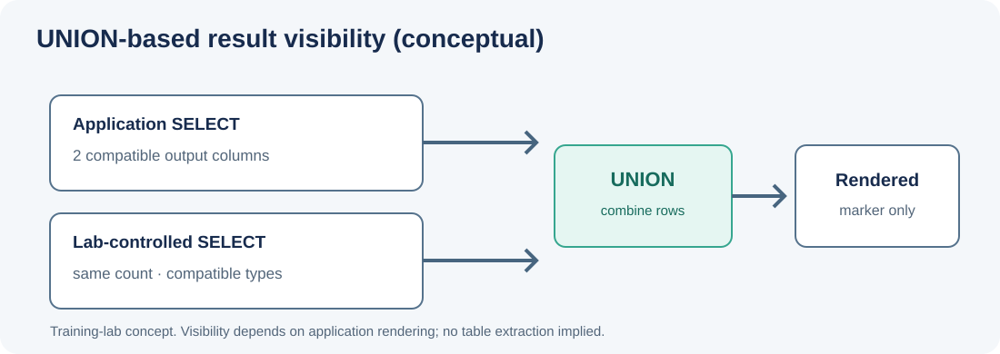

# SQL Injection: Core Concepts

## Query and request lifecycle

A web handler receives a request, validates and transforms values, constructs a database operation, sends it through a driver, and maps returned rows or errors into an HTTP response. SQL injection occurs when data from a less-trusted source is interpreted as SQL syntax because the application composes query text unsafely.

For example, a search handler might intend to execute:

```sql
SELECT id, title FROM products WHERE category = 'books'
```

If it builds SQL by concatenating a request value into quoted text, a crafted value may change the predicate or query structure. With a prepared statement, the SQL structure is parsed separately and the value is bound as data:

```sql
SELECT id, title FROM products WHERE category = ?
```

The exact placeholder syntax depends on the driver. Parameters protect values; they do not generally stand for identifiers, keywords, or whole clauses.

## Why vulnerabilities happen

Common causes include string concatenation, custom escaping, unsafe dynamic SQL inside stored procedures, ORM query-language concatenation, and assumptions that validation or a WAF makes concatenation safe. Vulnerable input can arrive through query strings, forms, JSON, cookies, headers, or data retrieved from another system. The important question is whether an untrusted value reaches a SQL parser as part of query syntax.

## Technique families



| Family | Observable channel | Typical evidence |
|---|---|---|
| In-band | Same request/response | Injected query results or a database error appear in the response |
| Error-based | Error text or error-dependent behavior | A database parser/type error is exposed or causes a distinctive response |
| UNION-based | Rows from a combined SELECT appear in the page/API response | A harmless marker returned in a compatible output column |
| Blind, boolean-based | Response differences | A true and false condition produce repeatable, meaningfully different responses |
| Blind, time-based | Response latency | A conditional delay occurs consistently beyond a matched baseline |

These are observation channels, not mutually exclusive root causes. A blind injection can still be an in-band request path; the distinction is whether useful query output is directly returned.

## Error-based testing

**What/how:** A syntax or type perturbation can make the database or application produce an error. Some systems expose database details; many return a generic error, log it server-side, or normalize the response.

**Recognize/test:** In a lab, submit a baseline and a minimally changed value that tests parsing, then compare status, body, and application behavior. Use one change at a time. A generic 500 alone is not proof: application bugs, validation, and upstream failures can look the same.

**Meaning and limits:** A database-specific error is a clue that query processing was affected, not proof of data access or a complete DBMS identification. Stop at the minimum evidence needed. Never induce errors on production systems outside scope.

**Common mistakes:** Treating every server error as SQLi, changing several request fields simultaneously, or using an error string from one database as universally valid.

**Defense:** Parameterize values, keep detailed diagnostics in protected server logs, and return generic client errors.

## UNION-based testing

`UNION` combines compatible result sets. For an injected SELECT to combine with an application's SELECT, each side must return the same number of columns and corresponding types must be compatible. Output is visible only if the application renders or otherwise exposes the combined rows.

A safe lab sequence is: identify a controllable parameter; determine whether it is in a quoted string or numeric expression; establish the original column count using the lab's prescribed low-impact technique; test compatible constant markers; observe which rendered position carries a marker. See [practical-examples.md](practical-examples.md) for schematic SQL and scope.

**Common mistakes:** Assuming a column count from page layout, mixing incompatible types, overlooking NULL/driver conversion behavior, and claiming successful extraction when the application does not display results. **Defense:** parameterization; least-privilege database credentials; avoid returning unnecessary columns.

## Database-specific differences

Comment syntax, string concatenation, metadata catalogs, delay functions, type coercion, identifier casing, and placeholder syntax vary by DBMS and configuration. Do not infer a DBMS from one generic response. Confirm only with multiple independent, low-impact indicators in an authorized lab, or report the engine as unknown.
